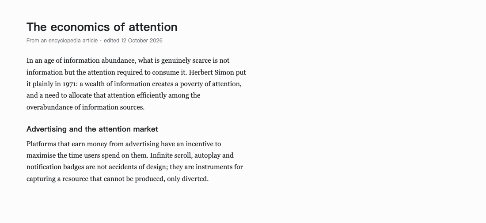

# 译解 (Yijie)

**[简体中文](README.zh-CN.md) | English**

> Select English on any page → a Chinese explanation appears in a side panel.
> Select Chinese → you get an English one. Bring your own API key, no backend.

A Chrome / Edge extension (Manifest V3) for people who read across languages.
It is a reading assistant, not just a translator: you get a translation first,
then terms, sentence structure and the intent behind the passage.

| English page → Chinese | Chinese page → English |
|---|---|
|  |  |

<sub>Demo content. Both panels are rendered from the shipped `panel.css`.</sub>

## Features

- **Works on any site** — one content script, `http(s)://*/*`, with a small
  exclusion list for sites that already have their own selection menus.
- **Streaming answers** — the text appears as the model writes it.
- **Two directions, auto-detected** — English text → Chinese explanation,
  Chinese text → English explanation. The button label follows the direction.
- **Bring your own key** — DeepSeek, OpenAI, a local Ollama, or any endpoint
  that speaks the OpenAI `/v1/chat/completions` protocol.
- **Editable prompts** — four of them (brief / detailed × two directions).
  Changes apply immediately, no page reload.
- **Per-site switch** — "Disable here" in the panel; re-enable in settings.
- **Keyboard** — `Alt+E` explains the selection, `Esc` closes the panel.
- **Dark mode** — follows the system setting.
- **No backend, no account, no telemetry.**

## Install (unpacked, for now)

1. Download or clone this repo.
2. Open `chrome://extensions` (or `edge://extensions`) and turn on
   **Developer mode**.
3. Click **Load unpacked** and pick the repo folder — the one containing
   `manifest.json`.
4. Click the toolbar icon → paste your API key → **Save**.

> Chrome Web Store listing is planned. Until then, loading unpacked is the
> only way to install.

## Configure


| Field | Notes |
|---|---|
| API Key | Stored in `chrome.storage.local`, never uploaded. Paste it exactly as issued — it is case-sensitive. |
| Base URL | Fill up to `/v1`; the extension appends `/chat/completions` itself. A full URL is also accepted. |
| Model | e.g. `deepseek-chat`, `gpt-4o-mini`, `qwen2.5:7b` |
| Output language | `auto` (Chinese source → English answer, otherwise Chinese) or `always Chinese` |

Presets:

| Provider | Base URL | Model |
|---|---|---|
| DeepSeek | `https://api.deepseek.com/v1` | `deepseek-chat` |
| OpenAI | `https://api.openai.com/v1` | `gpt-4o-mini` |
| Ollama (local) | `http://localhost:11434/v1` | your local model, e.g. `qwen2.5:7b` |
| Custom | any OpenAI-compatible endpoint | as documented by that provider |

When you save a custom endpoint, the browser asks for permission to access
that one host. You only grant the domain you typed.

**Local Ollama:** if the request fails with a network/CORS error, Ollama is
probably rejecting the extension origin. Start it with
`OLLAMA_ORIGINS=chrome-extension://*` (or `*` while testing) and restart Ollama.
On macOS: `launchctl setenv OLLAMA_ORIGINS "chrome-extension://*"`.

**Reasoning models** (o1, gpt-5, deepseek-reasoner) often reject `max_tokens`.
The extension retries once with `max_completion_tokens` automatically.

## Usage

1. Select at least 3 characters of text.
2. Click **解释 / Explain** on the left edge of the screen, or press `Alt+E`.
3. Read the answer on the right. Use **详解 / Detailed** for a longer version,
   **复制 / Copy** to copy it, **重新生成 / Regenerate** to try again.
4. `Esc` or `×` closes the panel and aborts the request.

## Privacy

- Your API key and settings live in `chrome.storage.local` on your machine.
  Nothing is synced or uploaded to us — there is no "us".
- The selected text is sent **directly from your browser to the endpoint you
  configured**, along with the surrounding paragraph (up to 600 characters) so
  the model can resolve pronouns.
- No analytics, no telemetry, no accounts, no device identifiers.
- Disable the extension per site, or remove it entirely — it holds no server
  state.

See [PRIVACY.md](PRIVACY.md) for details.

## Known limitations

- `chrome://`, `edge://`, the Chrome Web Store and PDF viewers cannot be
  injected. PDFs would need a PDF.js-based viewer.
- Some sites are excluded on purpose because they have their own selection
  menus: Gmail, Notion, Feishu, Google Docs.
- When the text lives inside a cross-origin iframe, the panel opens inside that
  iframe — it can look cramped in a very small frame.
- Page text in a canvas (Google Docs' canvas mode, some e-readers) is invisible
  to `window.getSelection()`.

## Troubleshooting

| Symptom | Likely cause |
|---|---|
| No button after selecting | Page not reloaded after installing; or the site is excluded; or the site is disabled |
| `API Key 无效或已失效（401）` | Wrong key, or the key lacks access to that model |
| `接口地址或模型名不对（404）` | Typo in base URL, or the model name does not exist |
| `请求太频繁或额度已用完（429）` | Rate limit or no balance |
| `连不上这个接口` | Wrong address, offline, needs a proxy, or the host was not granted |
| `10 秒没有返回` | Slow first token; the request is still running and will render when text arrives |
| `生成中断：20 秒没有收到新内容` | The stream stalled; the request was aborted |

## Development

No build step. Edit files, then hit the reload button on `chrome://extensions`.
After reloading, refresh any open tab — old tabs still run the previous content
script.

```bash
node test/background.test.mjs   # streaming parser, error mapping, retries
node test/lang.test.mjs         # Chinese / English detection

./scripts/check.sh              # the above + manifest, privacy scan, doc links
./scripts/build.sh              # dist/yijie-<version>.zip, ready for the store
```

Layout:

```
manifest.json        # MV3
src/defaults.js      # default prompts and endpoint
src/lang.js          # language detection
src/content.js       # selection, panel, rendering
src/background.js    # API calls, SSE parsing
src/options.*        # settings page
src/panel.css        # panel styles
icons/               # 16 / 48 / 128
scripts/             # check.sh, build.sh
docs/screenshots/    # README images
test/                # node unit tests, no browser needed
```

See [CONTRIBUTING.md](CONTRIBUTING.md).

## License

[MIT](LICENSE)
