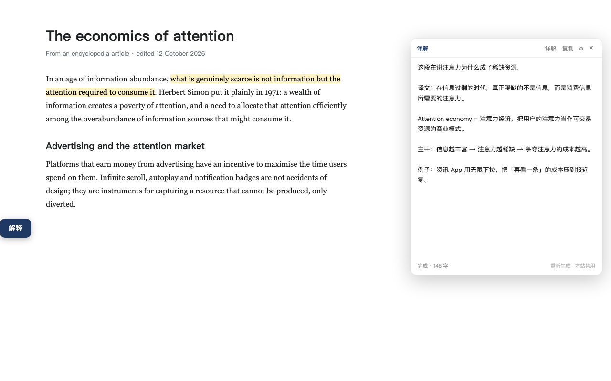
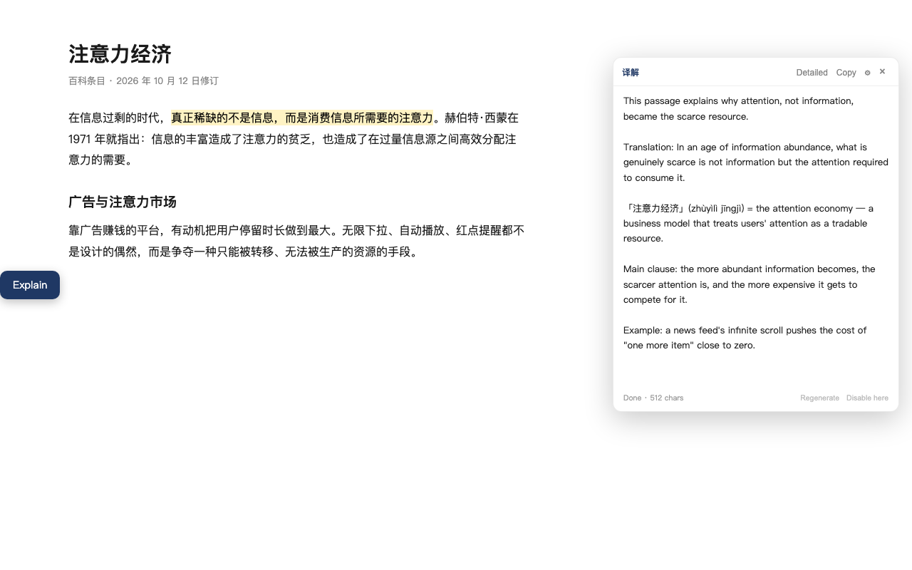
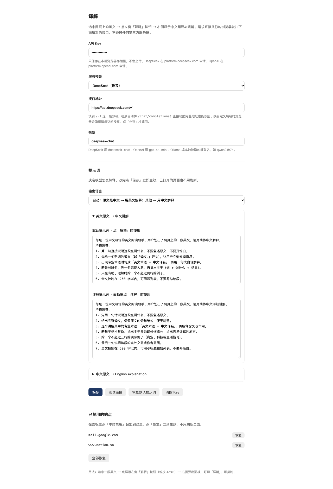

# 译解 (Yijie)

**简体中文 | [English](README.md)**

> 在任意网页选中英文，右侧弹出中文讲解；选中中文，弹出英文讲解。
> 自带 API Key，没有后端。

一个给「跨语言阅读」用的 Chrome / Edge 扩展（Manifest V3）。
它不只是翻译：先给译文，再讲术语、拆句子、说清言外之意。

| 英文页面 → 中文讲解 | 中文页面 → 英文讲解 |
|---|---|
|  |  |

## 功能

- **任意网站可用** — 一个 content script，匹配 `http(s)://*/*`，只排除自带划词菜单的少数站点
- **流式输出** — 模型写一个字显示一个字
- **自动双向** — 英文 → 中文讲解；中文 → 英文讲解。按钮文字会跟着变
- **自带 Key（BYOK）** — DeepSeek、OpenAI、本地 Ollama，或任何兼容 `/v1/chat/completions` 的接口
- **提示词可改** — 四段（简明 / 详解 × 两个方向），保存即生效，不用刷新页面
- **站点开关** — 面板里点「本站禁用」，设置页可恢复
- **快捷键** — `Alt+E` 解释选区，`Esc` 关闭面板
- **深色模式** — 跟随系统
- **无后端、无账号、无遥测**

## 安装（暂为解压加载）

1. 下载或克隆本仓库
2. 打开 `chrome://extensions`（Edge 是 `edge://extensions`），打开右上角 **开发者模式**
3. 点 **加载已解压的扩展程序**，选择**含 `manifest.json` 的那个文件夹**
4. 点工具栏图标 → 填 API Key → **保存**

> 应用商店上架中。在那之前只能这样安装。

## 配置



| 字段 | 说明 |
|---|---|
| API Key | 存在 `chrome.storage.local`，只在本机，不会上传 |
| 接口地址 | 填到 `/v1` 这一层即可，程序自动拼 `/chat/completions`；直接粘完整地址也认 |
| 模型 | 如 `deepseek-chat`、`gpt-4o-mini`、`qwen2.5:7b` |
| 输出语言 | `自动`（中文原文→英文，其余→中文）或 `始终中文` |

预设：

| 服务 | 接口地址 | 模型 |
|---|---|---|
| DeepSeek | `https://api.deepseek.com/v1` | `deepseek-chat` |
| OpenAI | `https://api.openai.com/v1` | `gpt-4o-mini` |
| 本地 Ollama | `http://localhost:11434/v1` | 你本地拉取的模型，如 `qwen2.5:7b` |
| 自定义 | 任意兼容接口 | 见该服务文档 |

保存自定义地址时，浏览器会单独请求该域名的访问权限——只授权你填的那一个域名。

**本地 Ollama 连不上**：多半是 Ollama 拒绝了扩展的来源。用
`OLLAMA_ORIGINS=chrome-extension://*`（测试时也可 `*`）启动并重启 Ollama。
macOS 上可 `launchctl setenv OLLAMA_ORIGINS "chrome-extension://*"`。

**推理模型**（o1、gpt-5、deepseek-reasoner）常拒绝 `max_tokens`，扩展会自动改用
`max_completion_tokens` 重试一次。

## 使用

1. 选中至少 3 个字符
2. 点屏幕左侧的 **解释 / Explain**，或按 `Alt+E`
3. 右侧看结果：**详解** 出更长的版本，**复制** 拿走文本，**重新生成** 换个说法
4. `Esc` 或 `×` 关闭面板并中止请求

## 隐私

- Key 和设置只存在本机 `chrome.storage.local`，不同步、不上传
- 选中的文字**由你的浏览器直接发往你自己配置的接口**，同时附带所在段落（最多 600 字）用于消解代词
- 无统计、无遥测、无账号、无设备标识
- 可以按站点禁用，也可以直接卸载——服务端不存任何东西

细节见 [PRIVACY.md](PRIVACY.md)。

## 已知限制

- `chrome://`、`edge://`、Chrome 应用商店、PDF 阅读器无法注入。要支持 PDF 得自己做 PDF.js 阅读器
- 有意排除的站点（自带划词菜单）：Gmail、Notion、飞书、Google Docs
- 正文在跨域 iframe 里时，面板会开在那个 iframe 内，frame 很小时会显得局促
- canvas 渲染的文字（Google Docs 画布模式、部分电子书）`window.getSelection()` 读不到

## 排错

| 现象 | 多半是 |
|---|---|
| 选词后没有按钮 | 装完没刷新页面；或站点被排除；或本站被禁用 |
| `API Key 无效或已失效（401）` | Key 不对，或没有该模型权限 |
| `接口地址或模型名不对（404）` | 地址拼错，或模型名不存在 |
| `请求太频繁或额度已用完（429）` | 限流或余额不足 |
| `连不上这个接口` | 地址错、断网、需要代理，或该域名未授权 |
| `10 秒没有返回` | 首字慢；请求仍在进行，内容到了会继续渲染 |
| `生成中断：20 秒没有收到新内容` | 流卡住，已主动中止 |

## 开发

没有构建步骤。改完代码在 `chrome://extensions` 点刷新即可。
**刷新扩展后要再刷新页面**——已打开的标签页仍在跑旧的 content script。

```bash
node test/background.test.mjs   # 流式解析、错误映射、重试
node test/lang.test.mjs         # 中英文判断

./scripts/check.sh              # 语法 + 测试 + manifest + 隐私红线 + 文档链接
./scripts/build.sh              # 产出 dist/yijie-<版本>.zip，可直接传商店
```

目录：

```
manifest.json        # MV3
src/defaults.js      # 默认提示词与接口
src/lang.js          # 语言判断
src/content.js       # 选区、面板、渲染
src/background.js    # 接口调用、SSE 解析
src/options.*        # 设置页
src/panel.css        # 面板样式
icons/               # 16 / 48 / 128
scripts/             # check.sh、build.sh
docs/screenshots/    # README 用图
test/                # Node 单元测试，不需要浏览器
```

改动前请看 [CONTRIBUTING.md](CONTRIBUTING.md)。

## 许可证

[MIT](LICENSE)
